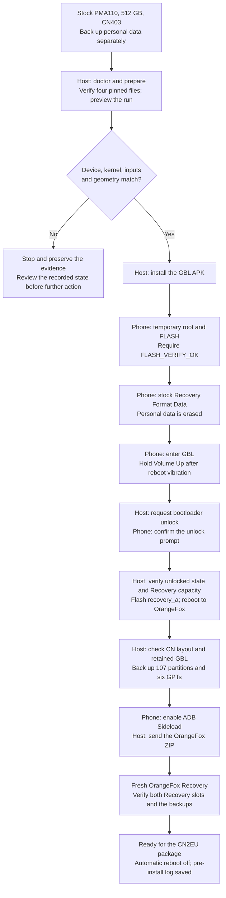
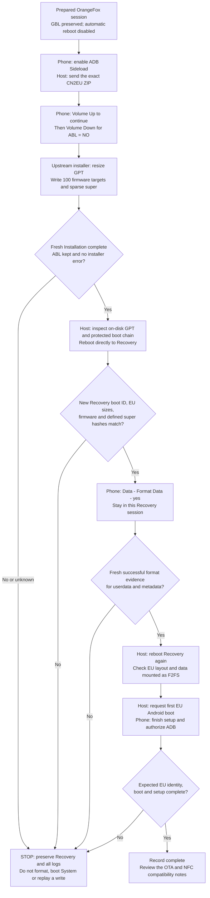
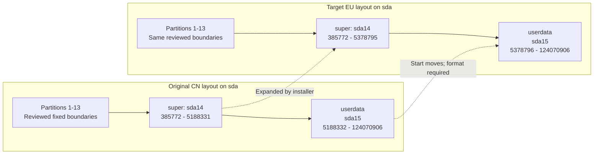
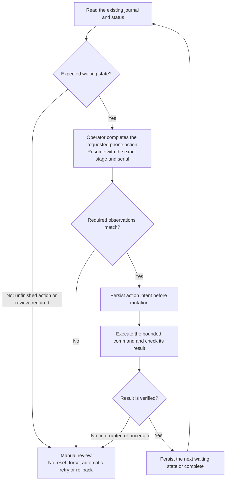

# Conversion flowcharts and checkpoints

English | [简体中文](FLOW.zh-CN.md) | [Project home](../README.md)

For offline reading or a viewer without Mermaid support, open the rendered SVGs: [1. Prepare Recovery](images/flow-1-en.svg) · [2. Convert and boot](images/flow-2-en.svg) · [3. Partition changes](images/flow-3-en.svg) · [4. Wait and stop](images/flow-4-en.svg). These are diagrams, not phone screenshots.

These diagrams describe the implemented workflow for **Find X9 Ultra (X9U), PMA110, 512 GB, CN403 → CPH2841 EU403**. Only one X9U has historical manual conversion evidence. The new CLI's complete sequence has not been run on a phone. Read the [command walkthrough](CLI.md) alongside these diagrams; a diagram is not an instruction to skip a checkpoint.

“Host” means an action performed or checked by the CLI after explicit execution. “Phone” means an action the operator must perform. The CN2EU package's own installer performs the GPT and firmware writes; this project invokes and checks it.

## 1. From stock China Android to a prepared Recovery

The firmware backup in this sequence happens **after** GBL installation, the stock Format Data, and the first Recovery image write. It excludes `userdata` and cannot recover personal data erased earlier. The historical manual case backed up 121 selected partitions; the new CLI implements its own 107-partition scope. Neither should be described as a pristine factory backup.

Android/Recovery ADB uses the original ADB serial. GBL may expose a different fastboot serial, which is explicitly bound at `waiting_gbl`. The CLI checks active slot A and a 104,857,600-byte `recovery_a` before flashing; it checks `recovery_b` capacity before the OrangeFox ZIP stage. Unexpected execution checks lead to a stop, including checks not drawn as separate decision nodes above.

## 2. From CN2EU sideload to EU Android

The host's transfer progress, including a percentage that appears to stop before 100%, is not the installation result. The CLI requires new Recovery-log evidence, then verifies 100 firmware target prefixes and 290 defined RAW/FILL regions in `super`. The 19 DONT_CARE regions have no expected byte content and are excluded from device readback comparison.

The first Recovery reboot makes the kernel reread the changed partition table. The reboot after Format Data checks the new `/data` filesystem in a fresh session. These are separate checkpoints. `complete` means the programmed conversion checks passed; it does not test all phone functions or certify OTA/NFC provisioning. See [real-device results](COMPATIBILITY.md).

## 3. What changes on storage

Logical sector size is 4,096 bytes. The following boundaries are inclusive and apply only to the reviewed 512 GB configuration.

| Component | Reviewed behavior | Why it matters |
| --- | --- | --- |
| `super` | Grows from 19,671,285,760 to 20,451,426,304 bytes | The package streams the sparse image to a raw disk offset; the old in-memory partition size may remain until Recovery reboots. |
| `userdata` | Its start moves; its end remains 124,070,906 | Do not place the conversion ZIP in internal storage. The CLI transfers it from the host using sideload. A normal wipe does not replace the required Format Data. |
| GPT entries 1–13 on `sda` | Their boundaries remain fixed | This is a layout statement: some contents, such as metadata during Format Data, still change. |
| 50 selected firmware images | Written to both slots: 100 targets | Initial conversion affects both slots. The later OTA updater has its own different partition policy. |
| `abl_a`, `abl_b`, EFISP | Existing GBL components retained | Select **ABL = NO** in the conversion installer. The CLI checks the pinned GBL content. |
| `recovery_a`, `recovery_b` | Device-specific OrangeFox retained | The OrangeFox IMG/ZIP stages install it; the CN2EU ROM stage skips its own Recovery image. |
| `userdata` and `metadata` | Formatted by the final OrangeFox Format Data operation | The tool requires fresh successful format records for both, then a new Recovery session. |

## 4. A checkpoint is not an automatic retry

Exit `3` means a normal human checkpoint. Exit `2` means a check or command failed; inspect `status`, because a usage/setup error need not change the journal while an execution failure can make it `review_required`. Exit `130` means interruption. The tool does not infer from a timeout or disconnect that no bytes were written. See the [exception table](TROUBLESHOOTING.md).

## 5. After conversion

Use the [published OTA updater](https://github.com/zhangckid/oppo-china-to-EU-OTA-updater) to study the separate, reviewed upgrade workflow when the built-in updater cannot upgrade this converted configuration. Its current documented baseline is EU `16.0.10.500` and it requires a verified local device profile; a phone just converted to EU403 is not automatically ready to run it. Follow that project's [Chinese documentation](https://github.com/zhangckid/oppo-china-to-EU-OTA-updater/blob/main/README.zh-CN.md) or English README.

The reported NFC problem is **card addition rejected by OPPO**. Domestic NFC apps themselves run normally on the reference phone. This converter and the OTA updater do not implement an NFC card-provisioning fix. Details and reporting boundaries are in [Compatibility](COMPATIBILITY.md).
