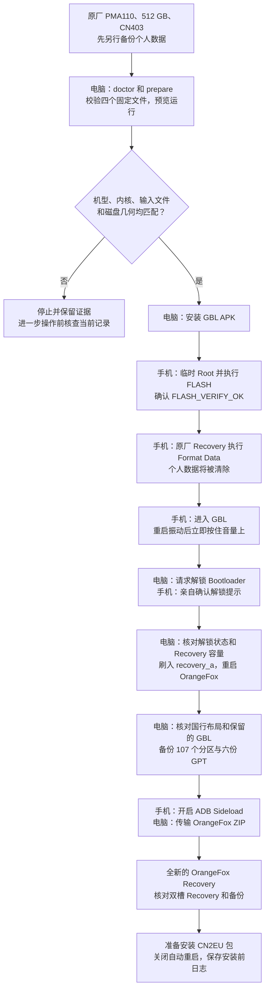
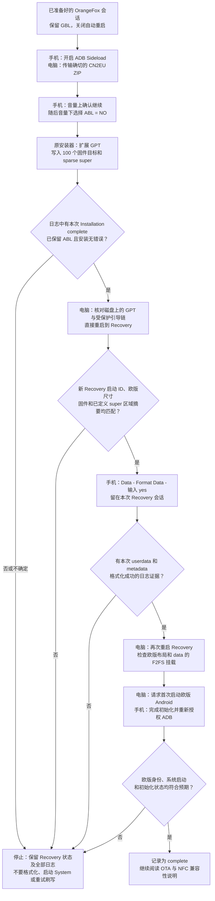
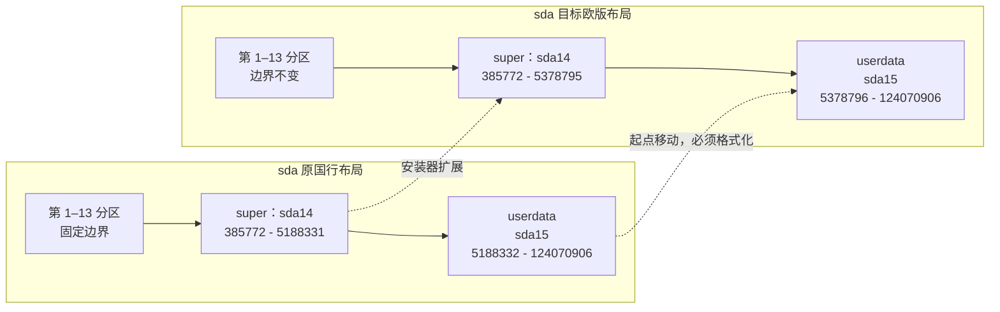
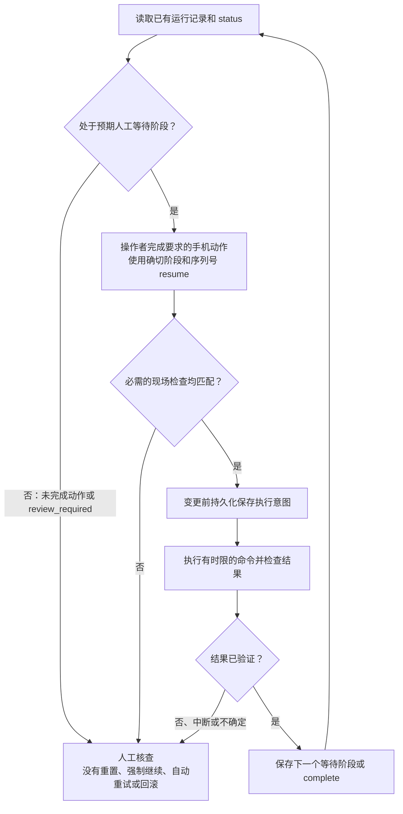

# 刷机流程图与检查点

[English](FLOW.md) | 简体中文 | [项目主页](../README.zh-CN.md)

离线阅读或页面未渲染 Mermaid 时，可打开已渲染的 SVG：[1. 准备 Recovery](images/flow-1-zh-CN.svg) · [2. 转版与首次开机](images/flow-2-zh-CN.svg) · [3. 分区变化](images/flow-3-zh-CN.svg) · [4. 等待与停止](images/flow-4-zh-CN.svg)。这些是流程示意图，不是手机截图。

这些图描述工具为 **Find X9 Ultra（X9U）、PMA110、512 GB、CN403 → CPH2841 EU403** 实现的流程。历史手工转版仅在一台 X9U 上有实机证据；新 CLI 的完整流程尚未在手机上执行。请配合[逐步命令教程](CLI.zh-CN.md)阅读，不能依据流程图跳过检查点。

图中“电脑”表示 CLI 在明确执行后完成或检查的动作；“手机”表示操作者必须亲自完成的动作。GPT 和固件写入由 CN2EU 包自带安装器负责，本项目负责调用和核验。

## 1. 从原厂国行 Android 到准备好的 Recovery

图中的固件备份发生在**安装 GBL、原厂 Format Data 和首次刷入 Recovery 镜像之后**。它不包含 `userdata`，无法找回前面已经清除的个人数据。历史手工案例备份了 121 个所选分区；新 CLI 实现的是自己的 107 个分区备份范围。两者都不能称为原始出厂备份。

Android 与 Recovery 使用原来的 ADB 序列号；GBL 可能显示另一序列号，在 `waiting_gbl` 阶段明确绑定。刷 Recovery 前，CLI 会检查活动槽为 A，且 `recovery_a` 为 104,857,600 字节；安装 OrangeFox ZIP 前检查 `recovery_b` 容量。图中未单独画出的执行检查如果出现意外，也会停止。

## 2. 从 CN2EU Sideload 到欧版 Android

电脑上的传输百分比不是安装结果，即使百分比看起来停在 100% 之前，也应看安装器日志。CLI 要求本次 Recovery 日志中的完成证据，再检查 100 个固件目标的镜像长度范围，以及 `super` 中 290 个已定义 RAW/FILL 区域。另有 19 个 DONT_CARE 区域没有确定的预期内容，不参与设备读回比较。

第一次重启 Recovery，是让内核重新读取变更后的分区表；Format Data 后再次重启 Recovery，是在新会话中检查 `/data` 文件系统。这是两个独立检查点。`complete` 表示程序设定的转版检查通过，不代表手机全部功能或 OTA/NFC 开卡能力都已通过测试。详见[实机体验](COMPATIBILITY.zh-CN.md)。

## 3. 存储布局发生什么变化

逻辑扇区为 4,096 字节。下列起止扇区均包含端点，且只适用于已审查的 512 GB 配置。

| 组件 | 已审查的行为 | 原因与含义 |
| --- | --- | --- |
| `super` | 从 19,671,285,760 增至 20,451,426,304 字节 | 安装包按原始磁盘偏移流式写入 sparse 镜像；Recovery 重启前，内核可能仍使用旧分区尺寸。 |
| `userdata` | 起点后移，终点仍为 124,070,906 | 转换包不能放在手机内部存储。CLI 从电脑通过 sideload 传输；普通清除不能代替所需的 Format Data。 |
| `sda` 第 1 至 13 个 GPT 分区 | 分区边界保持不变 | 这只指布局不变；部分内容仍会变化，例如 Format Data 会格式化 metadata。 |
| 50 个选定固件镜像 | 向双槽写入，共 100 个目标 | 首次转版涉及两个槽位；后续 OTA updater 使用另一套分区策略。 |
| `abl_a`、`abl_b`、EFISP | 保留已有 GBL 组件 | 转换包提示时必须选 **ABL = NO**；CLI 会核对固定的 GBL 内容。 |
| `recovery_a`、`recovery_b` | 保留设备专用 OrangeFox | OrangeFox IMG/ZIP 阶段负责安装；CN2EU ROM 安装阶段跳过包内自带的 Recovery 镜像。 |
| `userdata` 和 `metadata` | 由最后的 OrangeFox Format Data 格式化 | 工具要求两者本次格式化成功的日志，再进入全新的 Recovery 会话。 |

## 4. 检查点续行不等于自动重试

退出码 `3` 表示正常等待人工操作；`2` 表示检查或命令失败，需要查看 `status`：用法或主机准备错误可能不改变运行记录，执行阶段失败则可能使其进入 `review_required`。`130` 表示中断。工具不会把超时或断线解释为“没有写入任何字节”。具体响应见[异常处理表](TROUBLESHOOTING.zh-CN.md)。

## 5. 转版之后

当这个转版配置无法通过系统内置更新器升级时，可阅读已发布的 [OTA updater GitHub 仓库](https://github.com/zhangckid/oppo-china-to-EU-OTA-updater)，了解独立审查的后续升级流程。该项目当前文档基线是欧版 `16.0.10.500`，并要求经验证的本地设备配置；刚转到 EU403 的手机不等于已经具备直接执行 updater 的条件。具体见该项目的[中文文档](https://github.com/zhangckid/oppo-china-to-EU-OTA-updater/blob/main/README.zh-CN.md)或英文 README。

已反馈的 NFC 问题是**添加卡片时被 OPPO 拒绝**。国内 NFC App 本身在这台手机上正常运行。本转换工具和 OTA updater 都没有实现 NFC 加卡修复。范围与反馈方式见[兼容性说明](COMPATIBILITY.zh-CN.md)。
