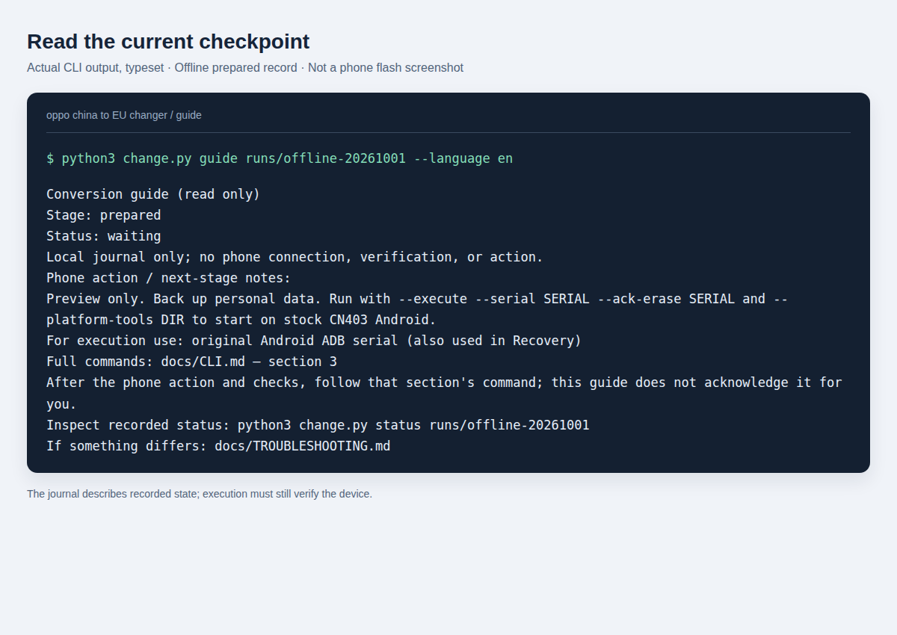
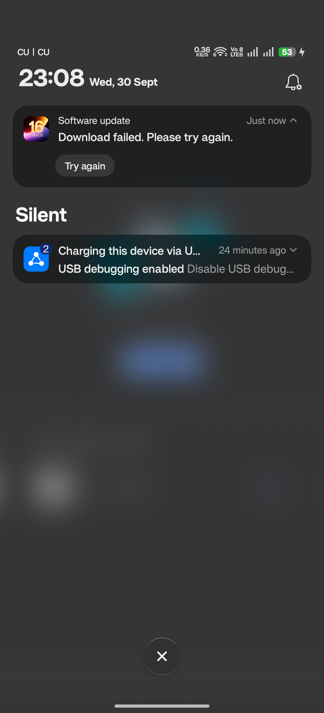

# Screenshots and visual checkpoints

English | [简体中文](SCREENSHOTS.zh-CN.md) | [Project home](../README.md)

Use this page with the [CLI walkthrough](CLI.md) and [flowcharts](FLOW.md). Screens help identify a checkpoint; they do not replace the journal, current logs or readback verification.

## 1. Read the current stage on the computer

This image is a browser rendering of **actual output** from the new CLI's `guide` command, reading the locally prepared offline run on 2026-10-01. It is a typeset terminal reference, **not a screenshot of a hardware flash**. The source [HTML](images/guide-en.html) is included; the [Chinese rendering](images/guide-zh-CN.png) is also available. The sample run directory shown in the image is not distributed. Create your own run with `prepare` and use its path.

Read these fields in order:

1. `Stage`: match this exact stage with the relevant CLI section.
2. `Status`: a waiting checkpoint permits only the documented handoff; unfinished or review states require a different response.
3. `Phone action / next-stage notes`: what the operator needs to do before the next executed command.
4. Serial type and CLI section: GBL and ADB identities may differ.

The guide itself does not connect to the phone. See [Start here](START_HERE.md) for its exit-code behavior.

## 2. Phone screen reference during conversion

**No historical GBL or OrangeFox flashing screenshots were retained in the available record.** We do not present reconstructed UI or another model's pictures as this phone's evidence. The following is a text reference to the recorded flow. The upstream [GBL instructions](https://github.com/koaaN/x9u-gbl-chainload-app) and [OrangeFox device release](https://github.com/koaaN/android_device_oppo_lighthouse-orangefox/releases/tag/v1.1) remain the sources for their own tools.

| Point in the flow | What to look for on the phone | Operator action / stop condition |
| --- | --- | --- |
| GBL application | Temporary-root and `FLASH` workflow; successful write/readback result `FLASH_VERIFY_OK` | Complete the upstream stock-Recovery Format Data requirement. Missing or different verification means stop. |
| GBL entry | The reference owner described “entered fastboot mode…” with Reboot / Enable fastboot controls | Screen wording alone does not establish the mode. Follow CLI section 4 and let its transport checks distinguish GBL from fastbootd; do not infer a button order from this description. |
| Unlock confirmation | The phone's bootloader-unlock prompt after the command | Read and confirm physically only in the documented stage. Do not use a relock command. |
| OrangeFox landing page | Files / recovery menu | This is a navigation page, not proof the previous ZIP succeeded. Match the journal stage and fresh log. |
| OrangeFox ZIP stage | ADB Sideload enabled | Receive the matching OrangeFox ZIP, then wait for the installer-requested Recovery reboot. |
| CN2EU first prompt | Installer asks whether to continue | For the pinned package, **Volume Up = continue**. Different prompts require review. |
| CN2EU ABL prompt | Installer asks whether to flash ABL | For the pinned package, **Volume Down = NO** to keep the current GBL. Do not select YES. |
| Firmware / `super` write | Installer progress and partition messages | Keep USB connected. Percentages do not establish completion; do not interrupt to obtain a picture. |
| Installer completion | Fresh `Installation complete` result and ABL-kept evidence in the log | Use the verification stages; do not jump directly to System or Format Data. |
| Final Format Data | Menu → Partitions management → Static partitions → Data → Format Data | Only at `waiting_format`, enter `yes`; wait for success and stay in that Recovery session for log capture. |
| First EU boot | Language selection / Android setup | Complete setup, re-enable and authorize ADB; the CLI still must verify the EU identity. |

The first format is in **stock OPPO Recovery after GBL installation**; the last is in **OrangeFox after conversion and verification**. Do not confuse them.

## 3. Actual post-conversion OTA failure capture

[Open original capture](images/ota-download-failed.png)

**Source:** Zhang Chen's reference X9U, captured during the 2026-09-30 post-conversion OTA investigation. The original image is included unchanged. It shows “Download failed. Please try again.” This generic notification alone does not establish a network problem, a checksum failure or the rejection's cause. It is not a screenshot of the initial conversion succeeding.

For the separate upgrade investigation and workflow, see [oppo china to EU OTA updater](https://github.com/zhangckid/oppo-china-to-EU-OTA-updater). Read its current supported baseline and profile requirements before use.

## 4. NFC and future screenshot contributions

The owner reports that domestic NFC apps run normally but OPPO rejects adding a card. No public screenshot here establishes the rejection's exact cause. Private wallet screens with account/card inventory are omitted. See [Compatibility](COMPATIBILITY.md) for the distinction between app operation and card provisioning.

For future evidence, save an exact build/stage description with each original capture. A separate camera may be needed in GBL or Recovery; never interrupt an active write to capture a screen. Review images for serials, IMEIs, accounts, card details, QR codes and notifications before sharing. Label annotations and recreated diagrams clearly, identify the contributor and obtain permission before including someone else's photo. Captured vendor UI and marks retain their original ownership; see [third-party notices](../THIRD_PARTY_NOTICES.md).
