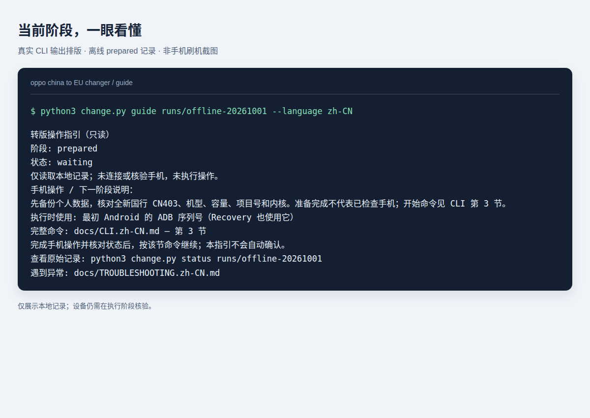

# 截图与画面对照

[English](SCREENSHOTS.md) | 简体中文 | [项目主页](../README.zh-CN.md)

请结合 [CLI 操作步骤](CLI.zh-CN.md)和[流程图](FLOW.zh-CN.md)阅读。画面用于识别检查点，不能代替阶段记录、当前日志和写后回读校验。

## 1. 在电脑上查看当前阶段

此图将新 CLI 的 `guide` 命令在 2026-10-01 读取本地离线准备记录的**真实输出**排版展示。它是终端输出参考图，**不是实机刷机截图**。随附 [HTML 源文件](images/guide-zh-CN.html)及[英文图](images/guide-en.png)。图中的样例运行目录不随源码发布；请用 `prepare` 创建自己的记录并填入其路径。

按顺序看：

1. `阶段`：准确匹配对应 CLI 章节，不能跳步。
2. `状态`：正常等待才对应预期交接；未完成操作、需核查状态要另行处理。
3. `手机操作 / 下一阶段说明`：执行下一条命令前，操作者需要在手机上做什么。
4. 序列号类型与 CLI 章节：GBL 与 ADB 的身份可能不同。

指引本身不连接手机；退出码含义见[入门页](START_HERE.zh-CN.md)。

## 2. 刷机时的手机画面对照

**现有记录没有保留当时 GBL、OrangeFox 刷写过程的实机截图。** 不使用重建界面或其他机型照片充当这台手机的证据。下表是历史流程的文字对照，各工具的说明仍以其上游 [GBL 文档](https://github.com/koaaN/x9u-gbl-chainload-app)与 [OrangeFox 设备发布页](https://github.com/koaaN/android_device_oppo_lighthouse-orangefox/releases/tag/v1.1)为来源。

| 流程位置 | 手机画面应关注什么 | 操作或停止条件 |
| --- | --- | --- |
| GBL 应用 | 临时 Root、`FLASH` 流程及写入回读成功标记 `FLASH_VERIFY_OK` | 按上游要求完成原厂 Recovery Format Data；缺少成功证据或提示不同就停止。 |
| 进入 GBL | 机主当时描述为“entered fastboot mode…”，下方有 Reboot / Enable fastboot 控件 | 单凭文字无法认定模式。按 CLI 第 4 节并由程序检查 GBL 与 fastbootd；不要从这段描述推断按钮顺序。 |
| 解锁确认 | 执行请求后手机上的 Bootloader 解锁提示 | 只在对应阶段阅读并亲自确认；不执行重新加锁。 |
| OrangeFox 首页 | Files / Recovery 菜单 | 只是导航页面，不代表前一个 ZIP 安装成功；仍需匹配阶段与新日志。 |
| OrangeFox ZIP 阶段 | 已开启 ADB Sideload | 传入匹配的 OrangeFox ZIP，等待安装器要求的 Recovery 重启。 |
| CN2EU 第一次提示 | 安装器询问是否继续 | 对固定版本包，**音量上 = 继续**；提示变化则停止核查。 |
| CN2EU ABL 提示 | 询问是否刷入 ABL | 对固定版本包，**音量下 = NO**，保留当前 GBL；不要选择 YES。 |
| 固件 / `super` 写入 | 安装进度、分区消息 | 保持 USB 连接；百分比不代表完成，不要为截图打断写入。 |
| 安装结束 | 日志中本次新的 `Installation complete` 及 ABL 保留证据 | 进入程序校验阶段，不直接跳到 System 或 Format Data。 |
| 最后一次 Format Data | Menu → Partitions management → Static partitions → Data → Format Data | 仅在 `waiting_format` 阶段输入 `yes`，等待成功并停留当前 Recovery 供取日志。 |
| 首次欧版开机 | 语言选择 / Android 初始化 | 完成初始化，重新开启 ADB 并授权；CLI 还需要核验欧版身份。 |

第一次格式化是在 **GBL 安装后的原厂 OPPO Recovery**；最后一次是在**转版与校验后的 OrangeFox**。不要混淆这两次操作。

## 3. 转版后 OTA 失败的真实截图

[查看原始截图](images/ota-download-failed.png)

**来源：** Zhang Chen 的参考 X9U，采集于 2026-09-30 转版后的 OTA 调查，图片原样收录。提示为“Download failed. Please try again.”。仅凭这个通用通知，不能判定是网络、摘要校验还是其他拒绝原因；这也不是初次转版成功的截图。

独立的升级调查与流程见 [oppo china to EU OTA updater](https://github.com/zhangckid/oppo-china-to-EU-OTA-updater)，实际使用前请核对该项目当前基线与 profile 要求。

## 4. NFC 与后续截图补充

机主反馈国内 NFC App 可以正常运行，但添加卡时被 OPPO 拒绝。本页没有能证明拒绝根因的公开截图，也未收录带有账户或卡片库存信息的私人钱包画面。App 运行与卡片开通的区别见[实机体验](COMPATIBILITY.zh-CN.md)。

后续补充证据时，请为原始照片记录确切版本和阶段。GBL 或 Recovery 可能需要另一台相机拍摄，不要为了取图打断正在执行的写入。分享前检查序列号、IMEI、账户、卡片、二维码及通知；标注后期说明和重绘示意图，写明贡献者，收录他人的照片前取得许可。厂商界面及标识仍归原权利人，见[第三方声明](../THIRD_PARTY_NOTICES.zh-CN.md)。
